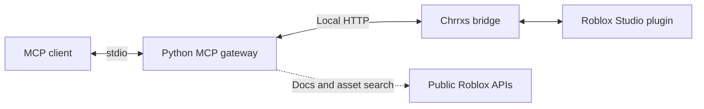

# Roblox Studio MCP Gateway

`mcp-roblox` is a Python Model Context Protocol (MCP) server for Roblox Studio. It works with MCP clients that can launch a local server over `stdio`. Use it to inspect a place, edit Luau and instance properties, work with Creator Store assets, and diagnose playtests.

The gateway adds an edit planner, dry runs for common writes, and a playtest summary based on runtime logs. It uses [Chrrxs's Roblox Studio bridge and plugin](https://github.com/Chrrxs/robloxstudio-mcp) to interact with Studio, and calls Roblox's public APIs for engine documentation and catalog search.



## Tools

The gateway exposes 33 tools.

| Group | Tools |
|---|---|
| Status and planning | `roblox_status`, `roblox_ensure_ready`, `roblox_plan` |
| Place and Explorer | `roblox_search`, `roblox_read`, `roblox_edit`, `roblox_attrs`, `roblox_tree`, `roblox_place`, `roblox_class`, `roblox_selection` |
| Luau scripts | `roblox_script_get`, `roblox_script_set`, `roblox_script_edit`, `roblox_script_lines`, `roblox_grep`, `roblox_replace`, `roblox_exec` |
| Playtesting | `roblox_solo`, `roblox_multiplayer`, `roblox_breakpoints`, `roblox_input`, `roblox_playtest`, `roblox_network`, `roblox_device` |
| Diagnostics | `roblox_capture`, `roblox_profile` |
| Assets and models | `roblox_toolbox`, `roblox_build`, `roblox_import`, `roblox_export` |
| Reference and snapshots | `roblox_docs`, `roblox_backup` |

## Requirements

- Python 3.10 or later for the gateway.
- Node.js 22 or later for `@chrrxs/robloxstudio-mcp` **3.1.0**.
- Roblox Studio with the matching **3.1.0** `MCPPlugin.rbxmx` plugin.

## Quick start

1. From the repository directory, install the Python gateway in its own virtual environment.

   ```bash
   python -m venv .venv
   .venv/bin/python -m pip install .
   ```

   On Windows, use `.venv\Scripts\python.exe` to install and `.venv\Scripts\mcp-roblox.exe` to launch the gateway.

2. Start the pinned bridge in a separate terminal and keep it running. The command installs the matching Studio plugin. For a custom plugin directory, set `MCP_PLUGINS_DIR` before running it.

   ```bash
   npx --yes @chrrxs/robloxstudio-mcp@3.1.0 --auto-install-plugin
   ```

3. Restart Roblox Studio, open a place, and verify the connection in **Plugins → MCP Server**.

## Configure your MCP client

Add a local **stdio** server using the absolute path to the installed executable. The client starts the Python gateway. The Studio bridge runs separately.

| Field | Value |
| --- | --- |
| Name | `roblox` |
| Command on Linux and macOS | `/path/to/project/.venv/bin/mcp-roblox` |
| Command on Windows | `C:\path\to\project\.venv\Scripts\mcp-roblox.exe` |
| Arguments | None |

Example for Cursor in `mcp.json`. Replace the executable path.

```json
{
  "mcpServers": {
    "roblox": {
      "type": "stdio",
      "command": "/path/to/project/.venv/bin/mcp-roblox"
    }
  }
}
```

Use the same executable in other clients that support stdio. [Cursor](https://cursor.com/docs/mcp) · [VS Code with Copilot](https://code.visualstudio.com/docs/agents/reference/mcp-configuration) · [OpenCode](https://opencode.ai/docs/mcp-servers/)

Call `roblox_status` and check for `plugin_connected: true`. Try a read-only request such as “Describe the open place and list the top-level instances.”

## Configuration

| Environment variable | Default | Purpose |
|---|---|---|
| `ROBLOX_BRIDGE_URL` | `http://127.0.0.1:58741` | HTTP address of the upstream bridge. |
| `ROBLOX_BRIDGE_TOKEN_FILE` | `~/.robloxstudio-mcp/auth-token` | Path to the bridge token file. |
| `MCP_PLUGINS_DIR` | Vinegar's default Studio plugins directory | Directory where the gateway checks for `MCPPlugin.rbxmx`. Set this to the active plugins folder when using another Studio installation or Wine prefix. |

Configure overrides in your MCP client's environment settings for the local server.

## Editing and playtesting

- `roblox_edit`, `roblox_script_set`, and `roblox_replace` preview writes by default. Review the preview before applying a change. Script line edits and asset imports write directly.
- `roblox_backup` saves a dated JSON snapshot of the project's structure to `~/.cache/mcp-roblox/backups/`. Save a Studio copy of the place for full restoration.
- `roblox_exec` requires `confirm: true` for server and client playtest execution. Run the bridge on loopback and use it with a trusted local MCP client.
- `roblox_toolbox` can preview models and delegates sanitized insertion to the plugin. Each call handles up to five insertions. Third-party assets require the matching permission in Studio.
- Use `roblox_solo` or `roblox_multiplayer` to start a session. `roblox_playtest` collects a screenshot and logs, then returns a heuristic verdict. A `rollback` verdict is advisory.
- `roblox_capture` supports `scene`, `memory`, `script`, and `micro`. Profiler captures require a connected server peer and are capped at 15 seconds for scripts and 5 seconds for MicroProfiler. Local `.rbxm` imports are capped at 37.5 MiB.
- To test network conditions, start a multiplayer session and pass `great`, `good`, or `poor` explicitly to `roblox_network`. The gateway targets the first client.

## Troubleshooting

| Symptom | What to check |
|---|---|
| `bridge: down` | Start the pinned bridge and check the address in `ROBLOX_BRIDGE_URL`. |
| `plugin_connected: false` | Restart Studio after plugin installation. Verify that the plugin panel shows a connection and that both versions are 3.1.0. |
| **MCP Server** is missing | Check the plugins folder for the active Studio installation or Wine prefix. Set `MCP_PLUGINS_DIR` to the directory containing `MCPPlugin.rbxmx`. |
| No peer for the requested role | Start a playtest with the required server or client before calling role-specific tools. |

## Development

The test suite exercises validation and backend requests with mocks. The MCP SDK verified the stdio connection and tool catalog. Individual clients and a live Studio session still need verification.

```bash
.venv/bin/python -m pip install pytest
.venv/bin/python -m pytest -q
```

## License

[MIT](LICENSE)
